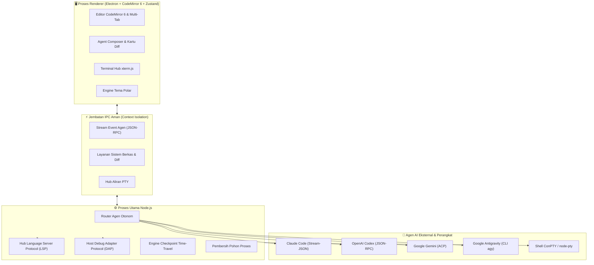

<p align="center">
  
</p>

<p align="center">
  <strong>Editor Kode AI Otonom Generasi Baru, Gratis &amp; Sumber Terbuka (Open Source).</strong><br/>
  Pair-programming mulus bersama agen AI otonom favorit Anda berdampingan dengan terminal nyata, server bahasa bawaan (LSP), dan debugger multi-bahasa (DAP) — dengan persetujuan granular baris-per-baris bagi manusia.
</p>

<p align="center">
  <a href="https://github.com/Nozella-Alexiee/alexel-studio/releases/latest"></a>
  <a href="#-agen-ai-yang-didukung"></a>
  <a href="#-unduh--instalasi"></a>
  <a href="#-privasi--tanpa-telemetri"></a>
  <a href="LICENSE"></a>
</p>

<p align="center">
  <a href="README.md"><b>English</b></a> · <a href="README.id.md"><b>Bahasa Indonesia</b></a> · <a href="#-unduh--instalasi"><b>Unduh</b></a> · <a href="#-perbandingan-vs-kompetitor"><b>Matriks Perbandingan</b></a> · <a href="#-arsitektur-sistem"><b>Arsitektur</b></a> · <a href="docs/AGENTS.md"><b>Protokol Agen</b></a>
</p>

---

<p align="center">
  
</p>

---

## 📑 Daftar Isi

- [✨ Mengapa Alexel Studio?](#-mengapa-alexel-studio)
- [⚖️ Perbandingan vs Kompetitor](#️-perbandingan-vs-kompetitor)
- [🤖 Agen AI yang Didukung](#-agen-ai-yang-didukung)
- [📸 Sorotan Fitur Unggulan](#-sorotan-fitur-unggulan)
  - [1. Persetujuan Diff Granular & Human-in-the-Loop](#1-persetujuan-diff-granular--human-in-the-loop)
  - [2. Time-Travel Checkpoint & Pemulihan Instan](#2-time-travel-checkpoint--pemulihan-instan)
  - [3. Debugger Multi-Bahasa Lengkap (DAP)](#3-debugger-multi-bahasa-lengkap-dap)
  - [4. Toko Agen & Marketplace Ekstensi Open VSX](#4-toko-agen--marketplace-ekstensi-open-vsx)
  - [5. Engine Tema Polar & Reaksi Maskot Nozi](#5-engine-tema-polar--reaksi-maskot-nozi)
  - [6. Terminal Cerdas ConPTY Lintas Platform](#6-terminal-cerdas-conpty-lintas-platform)
- [⚙️ Arsitektur Sistem](#️-arsitektur-sistem)
- [📥 Unduh & Instalasi](#-unduh--instalasi)
- [🔒 Privasi & Tanpa Telemetri](#-privasi--tanpa-telemetri)
- [⌨️ Referensi Shortcut Keyboard](#️-referensi-shortcut-keyboard)
- [🛠️ Membangun dari Sumber (Build from Source)](#️-membangun-dari-sumber-build-from-source)
- [📁 Tata Letak Proyek](#-tata-letak-proyek)
- [📄 Lisensi & Catatan Merek Dagang](#-lisensi--catatan-merek-dagang)

---

## ✨ Mengapa Alexel Studio?

Sebagian besar editor dengan AI memperlakukan kecerdasan buatan sekadar sebagai alat pelengkap otomatis (*auto-complete*) atau sebagai kotak hitam tak terkendali yang mengubah berkas di latar belakang tanpa pengawasan Anda.

**Alexel Studio dirancang dengan filosofi yang berbeda: *Anda tetap menjadi kapten di kursi kendali.***

1. **Persetujuan Granular Human-in-the-Loop**: Setiap perubahan kode, pembuatan berkas, dan perintah shell yang diusulkan oleh agen otonom akan ditampilkan dalam kartu pratinjau diff visual sebelum menyentuh disk Anda. Setujui per bagian, izinkan untuk satu sesi, atau tolak dengan masukan instan.
2. **Time-Travel Checkpoint**: Setiap pesan dalam percakapan berfungsi sebagai snapshot instan kondisi proyek Anda. Agen salah langkah? Cukup satu klik untuk mengembalikan seluruh direktori kerja ke kondisi sebelum pesan tersebut, sementara berkas baru hasil halusinasi aman dipindahkan ke Tempat Sampah (Trash).
3. **Bebas Keterikatan Vendor (No Lock-In)**: Masuk langsung menggunakan akun Claude, OpenAI, atau Google pribadi Anda. Anda tidak membayar biaya perantara markup API, dan langsung memakai biner resmi CLI di komputer Anda.
4. **Fondasi IDE Profesional**: Anda tidak mengorbankan perlengkapan inti demi AI. Alexel Studio menyertakan terminal pseudo asli (`node-pty` / Windows ConPTY), kecerdasan bahasa Language Server Protocol (LSP), dan sistem debugging multi-bahasa Debug Adapter Protocol (DAP).
5. **Privasi Mutlak**: Nol pelacak analitik, nol pengiriman data telemetri, dan tanpa server proxy perantara. Seluruh komunikasi mengalir langsung antara perangkat Anda dan penyedia AI yang Anda pilih.

---

## ⚖️ Perbandingan vs Kompetitor

Bagaimana Alexel Studio bersanding dengan lingkungan pengembangan terdepan saat ini:

| Fitur / Kemampuan | **Alexel Studio** | **Cursor** | **VS Code + Copilot** | **Zed** |
|---|:---:|:---:|:---:|:---:|
| **Harga & Lisensi** | **100% Gratis & Open Source (MIT)** | Berlangganan $20/bulan | Berlangganan $10–$19/bulan | Gratis (Open Core) |
| **Gunakan Akun / Kunci Sendiri (BYOK)** | ✅ **Ya (Tanpa markup)** | ⚠️ Terbatas / Tingkat Berbayar | ❌ Tidak | ⚠️ Hanya kunci API |
| **Agen Otonom Multi-Berkas** | ✅ **Claude, Codex, Gemini, Antigravity** | ⚠️ Hanya Cursor Composer | ⚠️ Hanya Copilot Edits | ⚠️ Hanya panel asisten |
| **Kartu Persetujuan Diff Granular** | ✅ **Terima / Tolak per blok** | ❌ Terapkan semua atau tidak sama sekali | ❌ Terapkan semua | ❌ Hanya diff baris |
| **Time-Travel Snapshot per Pesan** | ✅ **Pemulihan instan satu-klik** | ❌ Undo git manual | ❌ Undo git manual | ❌ Tidak ada |
| **Privasi & Telemetri** | 🛡️ **100% Bebas Telemetri** | ⚠️ Logging server proxy cloud | ⚠️ Telemetri bawaan luas | ⚠️ Telemetri penggunaan & crash |
| **Debugger Bawaan Multi-Bahasa (DAP)** | ✅ **Bawaan (Python, Node, C++, Rust)** | ✅ Bawaan | ✅ Bawaan | ⚠️ Sedang dikembangkan |
| **Dukungan Agent Client Protocol (ACP)** | ✅ **Driver kelas satu terintegrasi** | ❌ Protokol kepemilikan tertutup | ❌ Protokol tertutup | ❌ Protokol khusus |
| **Integrasi Terminal PTY** | ✅ **Native node-pty / Windows ConPTY** | ✅ Bawaan | ✅ Bawaan | ✅ Performa tinggi |

---

## 🤖 Agen AI yang Didukung

Alexel Studio hadir dengan driver bawaan yang dioptimalkan untuk agen pengodean otonom terkemuka dunia, serta jembatan protokol terbuka bagi agen mana pun yang mendukung **Agent Client Protocol (ACP)**:

| Agen | Penyedia | Kebutuhan Akun | Protokol Koneksi | Mode Izin |
|---|---|---|---|---|
| **Claude Code** | Anthropic | Claude Pro / Team / Max | Protokol CLI Stream-JSON | Tanya dulu, Edit otomatis, Rencana |
| **Codex** | OpenAI | ChatGPT Plus atau Kunci OpenAI | `codex app-server` (JSON-RPC) | Tanya dulu, Otomatis di folder, Baca saja |
| **Gemini** | Google | Akun Google atau Kunci Gemini | Agent Client Protocol (stdio) | Mode yang disediakan agen |
| **Antigravity** | Google | Akun Google | CLI `agy` mode Stream-JSON | Edit otomatis, Rencana, Ketat |
| **Agen ACP Kustom** | Komunitas | Tergantung penyedia | Agent Client Protocol (stdio) | Dapat dikonfigurasi via Pengaturan |

> 💡 **Sebutan Konteks (@-Mentions)**: Ketik `@problems`, `@terminal`, `@git-diff`, atau `@open-editors` dalam kotak pesan agen untuk mengirimkan status diagnostik IDE yang presisi secara otomatis.

---

## 📸 Sorotan Fitur Unggulan

### 1. Persetujuan Diff Granular & Human-in-the-Loop
<div align="center">
  
</div>

Jangan biarkan agen AI menimpa berkas Anda secara membabi buta. Setiap kali agen mengusulkan perubahan, Alexel Studio menampilkan kartu perbandingan diff visual yang rapi:
* **Tinjauan Per Bagian**: Terima atau Tolak blok kode tertentu hanya dengan satu klik.
* **Sandbox Izin Aman**: Eksekusi perintah shell (seperti `npm install` atau `pytest`) memerlukan konfirmasi eksplisit dengan opsi izin untuk sesi berjalan saja.
* **Koreksi Mandiri**: Menolak usulan diff secara otomatis mengirimkan alasan penolakan ke agen agar agen segera merevisi kodenya.

---

### 2. Time-Travel Checkpoint & Pemulihan Instan
Setiap kali Anda mengirim instruksi ke agen, sistem secara otomatis mengambil snapshot pohon kerja proyek Anda.
* **Eksplorasi Tanpa Rasa Khawatir**: Biarkan agen merombak kode arsitektur yang rumit. Jika hasilnya tidak sesuai ekspektasi, cukup klik *"Pulihkan berkas ke sebelum pesan ini"*.
* **Penghapusan Aman**: Berkas baru yang dibuat agen selama giliran tersebut dipindahkan ke Tempat Sampah sistem dan tidak langsung dimusnahkan permanen.

---

### 3. Debugger Multi-Bahasa Lengkap (DAP)
<div align="center">
  
</div>

Dibangun di atas standar resmi **Debug Adapter Protocol (DAP)**:
* Pasang breakpoint bersyarat, amati call stack eksekusi, pantau mutasi variabel, dan evaluasi ekspresi di Debug Console interaktif.
* Mendukung penuh **Python** (`debugpy`), **Node.js / TypeScript** (`js-debug`), **C / C++ / Rust** (`codelldb`), dan **Go** (`delve`).
* Agen AI dapat ikut bergabung ke sesi debug yang aktif untuk mendiagnosis uncaught exception secara seketika.

---

### 4. Toko Agen & Marketplace Ekstensi Open VSX
<div align="center">
  
</div>

Pasang tema, language server, dan driver agen otonom baru tanpa hambatan:
* Paket agen resmi divalidasi keutuhan integritasnya dengan checksum SHA-256 sebelum diekstrak.
* Telusuri ribuan tema dan grammar ramah VS Code langsung dari **Open VSX Registry**.

---

### 5. Engine Tema Polar & Reaksi Maskot Nozi
<div align="center">
  
</div>

* **6 Desain Tampilan**: Pilih antara 3 desain gelap modern (Aurora, Zen, Control Room) atau 3 desain polar kutub khas pinguin (Antartika, Tuxedo, Kawanan).
* **Maskot Interaktif (Nozi 🐧)**: Pinguin cerdas orisinal bereaksi dinamis terhadap aktivitas Anda: merayakan commit git yang sukses, berpikir saat agen AI bekerja, dan memberi tahu bila ada kesalahan program.

---

### 6. Terminal Cerdas ConPTY Lintas Platform
* **Presisi Windows**: Menggunakan `powershell.exe` asli dengan ConPTY dan bendera `-ExecutionPolicy Bypass`. Skrip npm dan file batch berjalan lancar tanpa menggantung.
* **macOS & Linux**: Pseudo-terminal POSIX bawaan dengan dukungan penuh warna ANSI 24-bit truecolor, integrasi zsh/bash, dan penghentian pohon proses yang bersih (`SIGTERM` / `SIGKILL`).

---

### 7. Kontrol Agen yang Setara Ekstensi Resmi
* **Opsi per model**: Level effort mengikuti model yang dipilih (model tanpa effort menyembunyikan kontrolnya), jadi panel tidak pernah menawarkan nilai yang ditolak CLI.
* Saklar **Ultracode** di bawah Effort, mode izin **Auto**, dan effort bisa diganti langsung tanpa memulai ulang percakapan.
* **Mode berbahaya tetap opt-in**: "Lewati semua izin" baru muncul setelah kamu menyalakannya di Pengaturan, dan tidak pernah jadi mode awal.
* **Slash command** (`/compact`, …) sampai ke agen apa adanya; `@problems`, `@terminal`, `@git-diff`, dan `@open-editors` menambah konteks.

---

## ⚙️ Arsitektur Sistem



---

## 📥 Unduh & Instalasi

Paket biner yang sudah dikompilasi tersedia langsung di **[Halaman Rilis GitHub](https://github.com/Nozella-Alexiee/alexel-studio/releases/latest)**:

### 🍏 macOS
* **Apple Silicon (M1/M2/M3/M4)**: [`Alexel-Studio-0.4.1-arm64.dmg`](https://github.com/Nozella-Alexiee/alexel-studio/releases/latest)
* **Intel**: [`Alexel-Studio-0.4.1.dmg`](https://github.com/Nozella-Alexiee/alexel-studio/releases/latest)

```bash
# Verifikasi macOS Gatekeeper (bila muncul dialog saat pertama kali dibuka):
xattr -cr /Applications/Alexel\ Studio.app
```

### 🪟 Windows
* **Windows 64-bit (x64)**: [`Alexel-Studio-Setup-0.4.1.exe`](https://github.com/Nozella-Alexiee/alexel-studio/releases/latest)
* **Windows ARM64**: [`Alexel-Studio-Setup-0.4.1-arm64.exe`](https://github.com/Nozella-Alexiee/alexel-studio/releases/latest)

### 🐧 Linux
* **AppImage Universal**: [`Alexel-Studio-0.4.1.AppImage`](https://github.com/Nozella-Alexiee/alexel-studio/releases/latest)
* **Debian / Ubuntu**: [`alexel-studio_0.4.1_amd64.deb`](https://github.com/Nozella-Alexiee/alexel-studio/releases/latest)
* **Fedora / RHEL**: [`alexel-studio-0.4.1.x86_64.rpm`](https://github.com/Nozella-Alexiee/alexel-studio/releases/latest)

---

## 🔒 Privasi & Tanpa Telemetri

Alexel Studio diciptakan dengan rasa hormat mendalam terhadap privasi pengembang dan keamanan kode Anda:

* **Bebas Pelacak**: Kami mengumpulkan 0 data analitik, 0 log galat, dan 0 statistik perilaku pengguna.
* **Koneksi Langsung**: Seluruh permintaan jaringan ke Anthropic, OpenAI, atau Google berlangsung langsung dari perangkat Anda sendiri tanpa melewati server perantara ketiga.
* **Perlindungan Berkas Rahasia**: Generator pesan commit AI secara otomatis menyaring dan mengabaikan file `.env`, token rahasia, kunci kredensial, dan lockfile.

---

## ⌨️ Referensi Shortcut Keyboard

| Perintah | Shortcut macOS | Shortcut Windows / Linux | Deskripsi |
|---|---|---|---|
| **Command Palette** | `⌘ ⇧ P` | `Ctrl + Shift + P` | Cari semua perintah dan aksi |
| **Buka Cepat Berkas** | `⌘ P` | `Ctrl + P` | Pencarian berkas cepat (fuzzy finder) |
| **Buka Panel Agen AI** | `⌘ ⎋` | `Ctrl + Esc` | Buka / fokus ke percakapan agen AI |
| **Edit AI Inline** | `⌘ K` | `Ctrl + K` | Minta AI merombak seleksi kode langsung |
| **Buka/Tutup Terminal** | `Ctrl + \`` | `Ctrl + \`` | Tampilkan / sembunyikan laci terminal |
| **Mulai / Lanjut Debug** | `F5` | `F5` | Luncurkan sesi adapter debug aktif |
| **Pesan Commit AI** | ✨ di Panel Git | ✨ di Panel Git | Tulis pesan commit otomatis dari diff staged |

---

## 🛠️ Membangun dari Sumber (Build from Source)

### Prasyarat
* **Node.js**: v20.x atau v22.x LTS
* **Manajer Paket**: `npm` v10+
* **Build Tools**: Python 3 dan perangkat build C++ (untuk mengompilasi modul native `node-pty`)

```bash
# 1. Klon repositori
git clone https://github.com/Nozella-Alexiee/alexel-studio.git
cd alexel-studio

# 2. Pasang dependensi
npm install

# 3. Jalankan mode pengembangan
npm run dev

# 4. Paketkan biner produksi
npm run dist:mac     # Buat paket .dmg macOS
npm run dist:win     # Buat installer .exe Windows
npm run dist:linux   # Buat paket .AppImage / .deb Linux
```

---

## 📁 Tata Letak Proyek

```
alexel-studio/
├── docs/                   # Aset dokumentasi, banner, dan screenshot
│   ├── assets/             # Banner SVG, logo, dan grafis vektor
│   └── screenshots/        # Screenshot resolusi tinggi fitur unggulan
├── electron/               # Proses utama Electron & backend native
│   ├── agents/             # Driver agen otonom: Claude, Codex, Gemini, Antigravity, ACP
│   ├── dap/                # Host Debug Adapter Protocol (debugpy, js-debug, lldb)
│   ├── lsp/                # Klien Language Server Protocol & pengelola proses
│   ├── pty/                # Jembatan terminal ConPTY / node-pty lintas platform
│   ├── git/                # Klien git native & generator pesan commit AI
│   └── runner/             # Eksekutor skrip run & pendeteksi toolchain sistem
├── src/                    # Proses renderer (React 18 + CodeMirror 6 + Zustand)
│   ├── components/         # Komponen UI (Chat agen, kartu diff, explorer, terminal)
│   ├── lib/                # Token tema, pemetaan shortcut, dan store state
│   └── styles/             # Variabel CSS modern, efek blur kaca, dan tema
├── site/                   # Website unduhan resmi & cerita gulir interaktif
├── package.json            # Skrip build dan dependensi runtime
└── electron-builder.json   # Konfigurasi pengemasan lintas platform
```

---

## 📄 Lisensi & Catatan Merek Dagang

Alexel Studio dilisensikan di bawah **[MIT License](LICENSE)**.

*Pemberitahuan Merek Dagang: Claude Code adalah merek dagang terdaftar milik Anthropic PBC. ChatGPT dan Codex adalah merek dagang OpenAI. Gemini dan Antigravity adalah merek dagang Google LLC. Alexel Studio adalah proyek sumber terbuka independen dan tidak terafiliasi secara resmi dengan Anthropic, OpenAI, maupun Google.*

Diciptakan dengan penuh dedikasi oleh **[Alex (Nozella-Alexiee)](https://github.com/Nozella-Alexiee)** &amp; para kontributor sumber terbuka 🐧
<br/>
*Memberdayakan para pengembang untuk membangun masa depan bersama agen AI otonom.*
