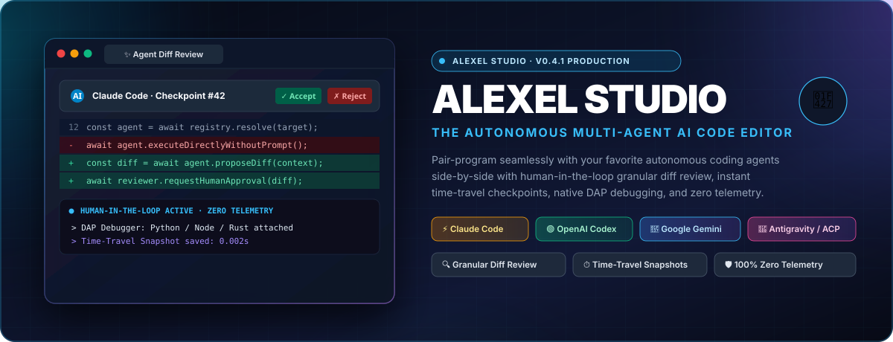
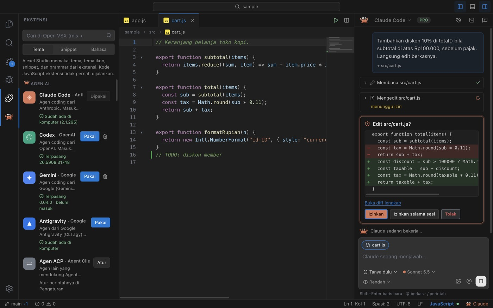
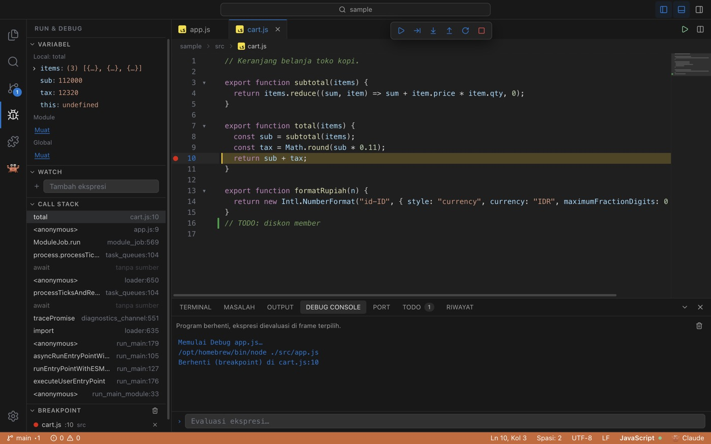
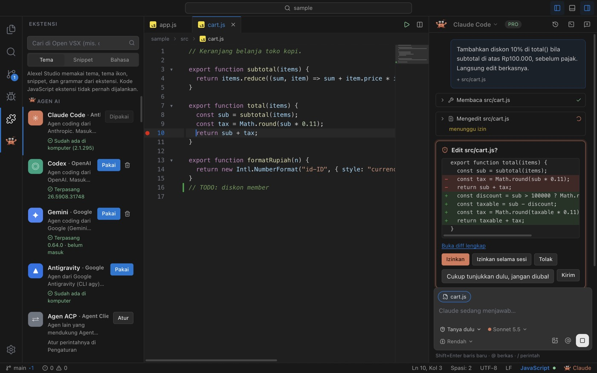
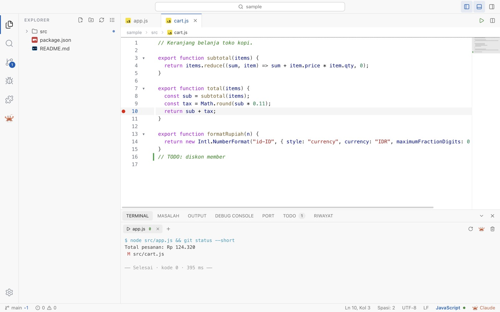
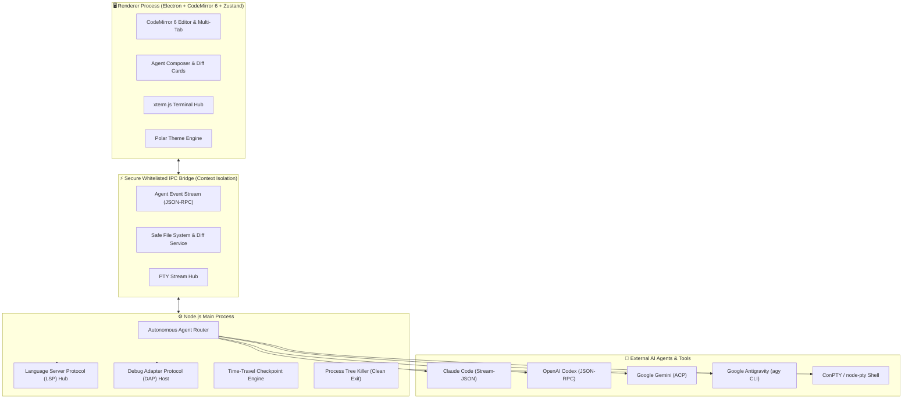

<p align="center">
  
</p>

<p align="center">
  <strong>The Next-Generation, Free &amp; Open Source Autonomous AI Code Editor.</strong><br/>
  Pair-program seamlessly with your favorite autonomous coding agents next to a real terminal, native language servers (LSP), and a multi-language debugger (DAP) — with human-in-the-loop granular diff review for every line of code.
</p>

<p align="center">
  <a href="https://github.com/Nozella-Alexiee/alexel-studio/releases/latest"></a>
  <a href="#-supported-ai-agents"></a>
  <a href="#-download--installation"></a>
  <a href="#-privacy--zero-telemetry"></a>
  <a href="LICENSE"></a>
</p>

<p align="center">
  <a href="README.md"><b>English</b></a> · <a href="README.id.md"><b>Bahasa Indonesia</b></a> · <a href="#-download--installation"><b>Download</b></a> · <a href="#️-feature-overview"><b>Feature Overview</b></a> · <a href="#-system-architecture"><b>Architecture</b></a> · <a href="docs/AGENTS.md"><b>Agent Protocols</b></a>
</p>

---

<p align="center">
  
</p>

---

## 📑 Table of Contents

- [✨ Why Alexel Studio?](#-why-alexel-studio)
- [⚖️ Feature Overview](#️-feature-overview)
- [🤖 Supported AI Agents](#-supported-ai-agents)
- [📸 Feature Highlights](#-feature-highlights)
  - [1. Granular Diff Approval & Human-in-the-Loop](#1-granular-diff-approval--human-in-the-loop)
  - [2. Time-Travel Checkpoints & Instant Rollback](#2-time-travel-checkpoints--instant-rollback)
  - [3. Full-Featured Multi-Language Debugger (DAP)](#3-full-featured-multi-language-debugger-dap)
  - [4. Agent Store & Open VSX Extension Marketplace](#4-agent-store--open-vsx-extension-marketplace)
  - [5. Polar Theme Engine & Mascot Reactions](#5-polar-theme-engine--mascot-reactions)
  - [6. Smart ConPTY & Cross-Platform Terminal](#6-smart-conpty--cross-platform-terminal)
- [⚙️ System Architecture](#️-system-architecture)
- [📥 Download & Installation](#-download--installation)
- [🔒 Privacy & Zero Telemetry](#-privacy--zero-telemetry)
- [⌨️ Keyboard Shortcuts Reference](#️-keyboard-shortcuts-reference)
- [🛠️ Building from Source](#️-building-from-source)
- [📁 Project Layout](#-project-layout)
- [📄 License & Trademark Notice](#-license--trademark-notice)

---

## ✨ Why Alexel Studio?

Most AI-assisted editors treat artificial intelligence either as an opaque auto-complete tool or as an uncontrolled black-box that silently modifies files in the background without your oversight.

**Alexel Studio is engineered on a fundamentally different philosophy: *You remain the captain in the pilot seat.***

1. **Human-in-the-Loop Granular Consent**: Every code modification, file creation, and shell command proposed by an autonomous agent is rendered as a crystal-clear visual diff card before anything touches your disk. Accept line-by-line, approve for the session, or reject with immediate conversational feedback.
2. **Time-Travel Checkpoints**: Every message in a conversation functions as an instantaneous snapshot of your project state. Made a wrong turn? One click restores your working tree to the state before that message, while newly created hallucinated files are safely moved to the Trash.
3. **No Vendor Lock-In**: Sign in directly with your own Claude, OpenAI, or Google account. You don't pay a markup on API calls, and you use the official CLI agents directly on your machine.
4. **Professional IDE Fundamentals**: You never sacrifice core tools for AI. Alexel Studio bundles a real pseudo-terminal (`node-pty` / Windows ConPTY), Language Server Protocol (LSP) intelligence, and full Debug Adapter Protocol (DAP) debugging.
5. **Absolute Privacy**: Zero analytics, zero telemetry trackers, and zero intermediary proxy servers. Communication flows directly between your machine and your chosen AI provider.

---

## ⚖️ Feature Overview

What you get in a single download:

| Capability | Alexel Studio |
|---|---|
| **Pricing & license** | Free & open source (MIT) |
| **Your own accounts** | Sign in with your own Claude, OpenAI or Google account — no markup |
| **AI agents** | Claude Code, Codex, Gemini, Antigravity, any ACP agent |
| **Change review** | Per-chunk accept / reject before anything touches disk |
| **Checkpoints** | One-click restore to the state before any message |
| **Built-in tools** | Database client, HTTP client, Docker, `.env` manager, notebooks, browser tab, Remote SSH |
| **Debugger** | Built-in DAP debugging (Python, Node, C/C++, Rust, Go) |
| **Terminal** | Native node-pty / Windows ConPTY |
| **Telemetry** | None |

---

## 🤖 Supported AI Agents

Alexel Studio comes out of the box with dedicated, native drivers for the industry's premier autonomous coding agents, as well as an extensible bridge for any agent supporting the **Agent Client Protocol (ACP)**:

| Agent | Provider | Account Required | Connection Protocol | Permission Modes |
|---|---|---|---|---|
| **Claude Code** | Anthropic | Claude Pro / Team / Max | Stream-JSON CLI protocol | Ask first, Edit automatically, Plan |
| **Codex** | OpenAI | ChatGPT Plus or OpenAI Key | `codex app-server` (JSON-RPC) | Ask first, Auto in folder, Read-only |
| **Gemini** | Google | Google Account or Gemini Key | Agent Client Protocol (stdio) | Modes offered by agent |
| **Antigravity** | Google | Google Account | `agy` CLI Stream-JSON mode | Edit automatically, Plan, Strict |
| **Any ACP Agent** | Community | Provider specific | Agent Client Protocol (stdio) | Customizable via Settings |

> 💡 **Context Mentions**: Type `@problems`, `@terminal`, `@git-diff`, `@open-editors`, or `@db` (database schema) in any conversation prompt to automatically feed exact IDE diagnostic state directly to the agent.

---

## 📸 Feature Highlights

### 1. Granular Diff Approval & Human-in-the-Loop
<div align="center">
  
</div>

Never let an AI agent overwrite your files blindly. Whenever an agent proposes changes, Alexel Studio displays a side-by-side or inline diff card:
* **Per-Chunk Review**: Accept or Reject individual modified blocks with a single click.
* **Safety Sandbox**: Shell execution commands (such as `npm install` or `pytest`) require explicit approval with an option to permit during the active session only.
* **Diff Reversion**: Rejecting a proposed diff instantly sends constructive feedback back to the agent for self-correction.

---

### 2. Time-Travel Checkpoints & Instant Rollback
Every prompt submitted to an agent generates an immutable checkpoint snapshot of your working tree.
* **Non-Destructive Exploration**: Let agents refactor complex architectures with zero fear. If the solution is suboptimal, click *"Restore files to before this message"*.
* **Trash Recovery**: Files created by the agent during that turn are cleanly moved to the OS Trash instead of permanently deleting your disk data.

---

### 3. Full-Featured Multi-Language Debugger (DAP)
<div align="center">
  
</div>

Built upon the official **Debug Adapter Protocol (DAP)**:
* Set conditional breakpoints, inspect call stacks, watch variable mutations, and evaluate expressions in the interactive Debug Console.
* First-class support for **Python** (`debugpy`), **Node.js / TypeScript** (`js-debug`), **C / C++ / Rust** (`codelldb`), and **Go** (`delve`).
* AI agents can attach directly to debugging sessions to diagnose uncaught runtime exceptions in real time.

---

### 3b. Updating
Open **Settings → Check now** (or the notification that appears when a new version is out) and choose **Install update**. The installer is downloaded from this repository's GitHub release, verified with its SHA-512, and applied on restart. Works on Windows, macOS and Linux AppImage; deb/rpm users update through apt/dnf.

### 4. Agent Store & Open VSX Extension Marketplace
<div align="center">
  
</div>

Install agents and Open VSX extensions with zero friction:
* Official agents are verified against SHA-256 integrity checksums before extraction.
* Browse the whole **Open VSX Registry** (20,000+ extensions): search without picking a category, sort by downloads/rating/newest, page through results, and read each extension's README, changelog and versions.
* Every result shows up front, before downloading, what it can do: **Full** (themes, icon themes, snippets, grammars, language configuration), or **Runs code (experimental)**. Extensions that contain code run in a separate **extension host** with a growing subset of the extension API *after you trust them* (completion, hover, definitions, formatting, diagnostics, decorations, commands & keybindings, status bar items, quick pick, settings, tree views, webviews, language-client based extensions). Verified with the real Prettier, ESLint, Red Hat YAML, Prisma, Error Lens, Todo Tree, REST Client, Code Spell Checker and others; the API is **not** complete yet, so some extensions will only partly work.
* Extension details page (Details / Features / Changelog), extension settings UI, recommendations for your project, update checks, enable/disable, trust control.
* Manage installed extensions: enable/disable, update (single or all), install a specific version. Installs are atomic.
* **One-click language servers** for YAML, Prisma and Dockerfile (pinned + SHA-256 verified, confirmed before they run).
* **Prettier is built in**: Shift+Alt+F formats JS/TS, JSON, CSS/SCSS/Less, HTML, Markdown and YAML, honouring `.prettierrc`; optional format on save.

---

### 5. Polar Theme Engine & Mascot Reactions
<div align="center">
  
</div>

* **8 Distinct Designs**: the classic Studio layout (dark & light), three modern designs (Aurora, Zen, Control Room) and three polar Antarctic ones (Antartika, Tuxedo, Kawanan). Every design is checked for WCAG AA contrast.
* **Interactive Mascot (Nozi 🐧)**: The original penguin companion reacts dynamically to your environment: celebrates successful git commits, thinks during agent reasoning turns, and raises alerts when errors occur.

---

### 6. Smart ConPTY & Cross-Platform Terminal
* **Windows Precision**: Uses native `powershell.exe` with ConPTY and `-ExecutionPolicy Bypass`. NPM scripts and batch files run smoothly without hanging processes.
* **macOS & Linux**: Native POSIX pseudo-terminals with full ANSI 24-bit truecolor support, zsh/bash integration, and clean process tree termination (`SIGTERM` / `SIGKILL`).

---

### 7. Agent Controls That Match the Official Extensions
* **Per-model options**: Effort levels come from the selected model (a model without effort hides the control), so the panel never offers a value the CLI would reject.
* **Ultracode** switch under Effort, **Auto** permission mode, and live effort changes without restarting the conversation.
* **Dangerous modes stay opt-in**: "Skip all permissions" only appears after you turn it on in Settings, and is never a starting mode.
* **Slash commands** (`/compact`, …) reach the agent untouched; `@problems`, `@terminal`, `@git-diff` and `@open-editors` add context.

---

### 8. Everyday Editor, Git & Workspace Tools
* **Git**: stash, fetch, merge / rebase / cherry-pick / revert with a conflict banner, branch & tag management, stage or revert a single change from the gutter, current-line blame, a commit graph and a commit view.
* **Editor**: indent guides, bracket pair colors, Emmet, color picker, sticky scroll, pinned tabs, split terminal, PDF preview and a hex viewer.
* **Extensions**: CodeLens, inlay hints, ghost-text suggestions, a Tests view and extension tasks; the official Claude Code and Codex extensions get their own panel tabs.
* **Workspaces & profiles**: multi-root `.code-workspace` files, settings profiles you can export/import, and Workspace Trust (restricted mode for untrusted folders).
* **Accessibility**: labelled controls and high-contrast (forced colors) support.

### 9. Built-in Database, API, Docker, Notebook, Browser & Remote SSH
* **Database**: PostgreSQL, MySQL/MariaDB, SQLite, MongoDB and Redis with table editing, `.sql` files (Mod+Enter), schema autocomplete, ER diagrams, AI "ask your data", and safety checks for risky queries. Passwords are encrypted with your OS keychain.
* **HTTP client**: `.http`/`.rest` files, environments, encrypted secrets, cURL import/export, and a request builder.
* **Docker & .env**: containers and compose from a panel; `.env` files as a table with git-ignore warnings.
* **Notebooks**: Jupyter `.ipynb` with a real local kernel.
* **Browser tab**: an isolated browser for your dev server with device presets and DevTools.
* **Remote SSH (lite)**: browse/edit server files and open terminals through your own `ssh` setup.

**Not there yet** (honest list): full remote development (language servers on the server), WSL/development containers, real-time collaboration, cloud settings sync, code signing (macOS/Windows builds are unsigned), UI languages besides English and Indonesian, and the full extension API, so some extensions only partly work.

---

## ⚙️ System Architecture



---

## 📥 Download & Installation

Pre-compiled binary packages are available directly from the **[Releases Page](https://github.com/Nozella-Alexiee/alexel-studio/releases/latest)**:

### 🍏 macOS
* **Apple Silicon (M1/M2/M3/M4)**: [`Alexel-Studio-mac-arm64.dmg`](https://github.com/Nozella-Alexiee/alexel-studio/releases/latest/download/Alexel-Studio-mac-arm64.dmg)
* **Intel**: [`Alexel-Studio-mac-x64.dmg`](https://github.com/Nozella-Alexiee/alexel-studio/releases/latest/download/Alexel-Studio-mac-x64.dmg)

```bash
# macOS Gatekeeper verification (if prompted on first launch):
xattr -cr /Applications/Alexel\ Studio.app
```

### 🪟 Windows
* **Windows 64-bit (x64)**: [`Alexel-Studio-win-x64.exe`](https://github.com/Nozella-Alexiee/alexel-studio/releases/latest/download/Alexel-Studio-win-x64.exe)
* **Windows ARM64**: [`Alexel-Studio-win-arm64.exe`](https://github.com/Nozella-Alexiee/alexel-studio/releases/latest/download/Alexel-Studio-win-arm64.exe)

### 🐧 Linux
* **Universal AppImage**: [`Alexel-Studio-linux-x86_64.AppImage`](https://github.com/Nozella-Alexiee/alexel-studio/releases/latest/download/Alexel-Studio-linux-x86_64.AppImage)
* **Debian / Ubuntu**: [`Alexel-Studio-linux-amd64.deb`](https://github.com/Nozella-Alexiee/alexel-studio/releases/latest/download/Alexel-Studio-linux-amd64.deb)
* **Fedora / RHEL**: [`Alexel-Studio-linux-x86_64.rpm`](https://github.com/Nozella-Alexiee/alexel-studio/releases/latest/download/Alexel-Studio-linux-x86_64.rpm)

---

## 🔒 Privacy & Zero Telemetry

Alexel Studio was created out of deep respect for developer privacy and enterprise intellectual property:

* **No Tracking**: We collect 0 analytics, 0 error logs, and 0 user behavior statistics.
* **Direct Connections**: All network calls to Anthropic, OpenAI, or Google occur directly from your device. No third-party proxy ever touches your codebase.
* **Secret Protection**: AI commit messages automatically sanitize and ignore `.env`, secret keys, credentials, and lockfiles.

---

## ⌨️ Keyboard Shortcuts Reference

| Command | macOS Shortcut | Windows / Linux Shortcut | Description |
|---|---|---|---|
| **Command Palette** | `⌘ ⇧ P` | `Ctrl + Shift + P` | Search all commands and actions |
| **Quick Open File** | `⌘ P` | `Ctrl + P` | Fast fuzzy file picker |
| **Toggle AI Agent Panel** | `⌘ ⎋` | `Ctrl + Esc` | Open / focus active AI agent conversation |
| **Inline AI Edit** | `⌘ K` | `Ctrl + K` | Ask AI to rewrite selected code directly |
| **Toggle Terminal** | `Ctrl + \`` | `Ctrl + \`` | Toggle integrated terminal drawer |
| **Start / Continue Debug** | `F5` | `F5` | Launch active debug adapter session |
| **AI Commit Message** | ✨ in Git Panel | ✨ in Git Panel | Generate commit message from staged diff |

---

## 🛠️ Building from Source

### Prerequisites
* **Node.js**: v20.x or v22.x LTS
* **Package Manager**: `npm` v10+
* **Build Tools**: Python 3 and C++ build tools (for compiling native `node-pty`)

```bash
# 1. Clone repository
git clone https://github.com/Nozella-Alexiee/alexel-studio.git
cd alexel-studio

# 2. Install dependencies
npm install

# 3. Start development mode
npm run dev

# 4. Package for production
npm run dist:mac     # Package macOS .dmg
npm run dist:win     # Package Windows .exe
npm run dist:linux   # Package Linux .AppImage / .deb
```

---

## 📁 Project Layout

```
alexel-studio/
├── docs/                   # Documentation assets, banners, and screenshots
│   ├── assets/             # SVG banners, logos, and vector illustrations
│   └── screenshots/        # High-resolution screenshots of core features
├── electron/               # Electron main process & native system backends
│   ├── agents/             # Autonomous agent drivers: Claude, Codex, Gemini, Antigravity, ACP
│   ├── dap/                # Debug Adapter Protocol host (debugpy, js-debug, lldb)
│   ├── lsp/                # Language Server Protocol client & process manager
│   ├── pty/                # ConPTY / node-pty cross-platform terminal bridge
│   ├── git/                # Native git client & AI commit message generator
│   └── runner/             # Smart run script executor & toolchain detector
├── src/                    # Renderer process (React 18 + CodeMirror 6 + Zustand)
│   ├── components/         # UI components (Agent chat, Diff cards, Explorer, Terminal)
│   ├── lib/                # Theme tokens, keyboard shortcuts, and state stores
│   └── styles/             # Modern CSS variables, glassmorphism blurs, and themes
├── site/                   # Official product download website & interactive scroll story
├── package.json            # Build scripts and runtime dependencies
└── electron-builder.json   # Multi-platform distribution packaging configuration
```

---

## 📄 License & Trademark Notice

Alexel Studio is licensed under the **[MIT License](LICENSE)**.

*Disclaimer: Claude Code is a registered trademark of Anthropic PBC. ChatGPT and Codex are trademarks of OpenAI. Gemini and Antigravity are trademarks of Google LLC. Alexel Studio is an independent open-source project and is not officially affiliated with Anthropic, OpenAI, or Google.*

Crafted with care by **[Alex (Nozella-Alexiee)](https://github.com/Nozella-Alexiee)** &amp; open-source contributors 🐧
<br/>
*Empowering developers to build the future with autonomous AI agents.*
