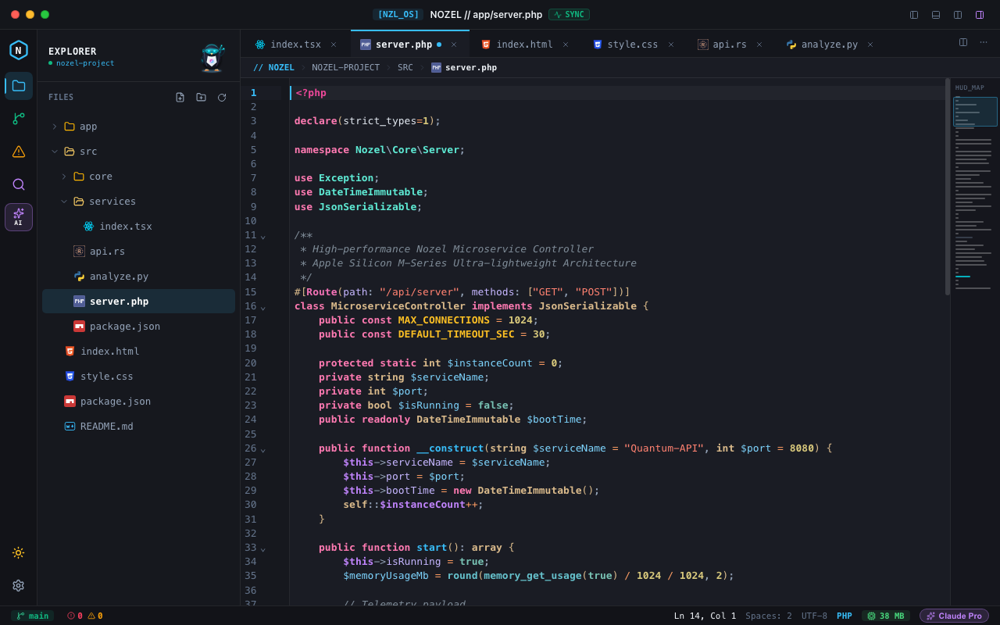
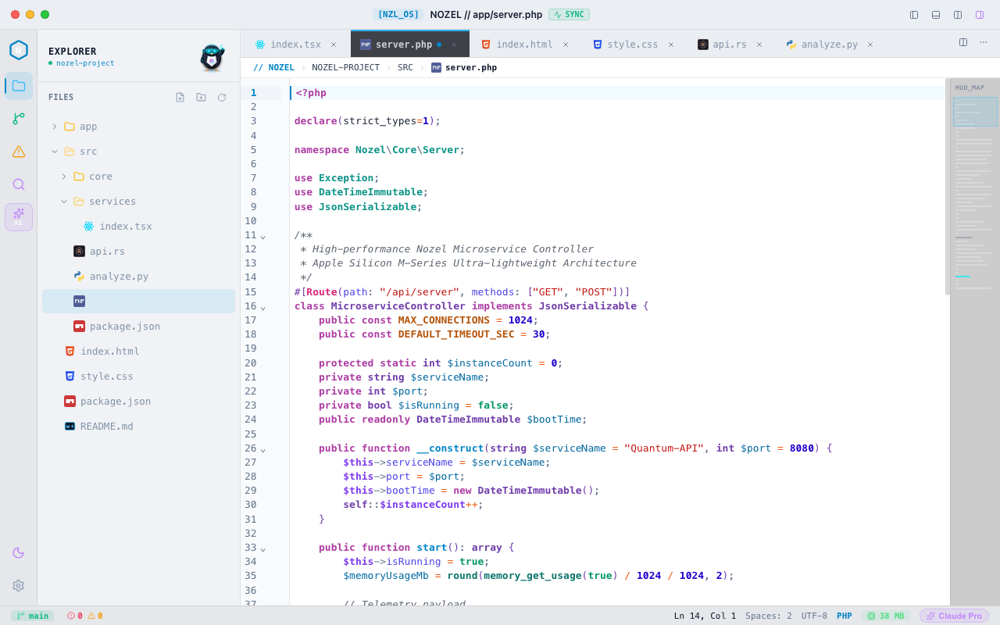

# Walkthrough: Full Vibrant PHP Language & Syntax Highlighting in Nozel Code ⚡

## 1. Problem Diagnosis & Deep Root Cause Analysis
The user reported that PHP code appeared in plain white text with minimal coloration ("tulisan e putih semua... minim banget warna e").

While the initial attempt added `@codemirror/lang-php`, an in-depth AST token analysis revealed why PHP code was **still largely rendering in plain white / muted text**:
1. **Property Names (`$this->serviceName`) were mapped to Default Text Color**:
   - In `src/utils/syntaxTheme.ts`, `t.propertyName` was styled as `#e2e8f0` (Apple Silver / Slate-200), which was **identical to the editor's base unstyled text color** (`color: #e2e8f0` in `EditorView.theme`).
   - Consequently, in PHP code where properties dominate (`$this->serviceName`, `$this->port`, `$this->isRunning`, `$data["status"]`), all property names were completely white.
2. **`$this` in Member Expressions fell back to White**:
   - `@lezer/php` parses `$this->...` with tag `tags.special(tags.propertyName)`.
   - The prior theme only configured `tags.special(tags.variableName)`. As a result, `$this` fell back to `propertyName` (`#e2e8f0`), rendering `$this` completely white as well.
3. **Lezer PHP Upstream Missing Tags**:
   - `readonly`: `@lezer/php` omitted `readonly` from `styleTags`, leaving PHP 8.1+ `readonly` modifiers unstyled (white).
   - `HeredocString`: Multi-line heredoc/nowdoc templates (`<<<HTML ... HTML;`) were completely omitted from `styleTags`, rendering heredoc code blocks as 100% unstyled white text.
   - Class inheritance (`extends BaseClass`), interface implementation (`implements Interface`), and instantiations (`new CustomClass()`) only tagged the definition name and left referenced classes unstyled.
   - Scoped class calls (`self::$count`, `parent::__construct()`, `Class::method()`) had untagged class references.
   - Constants (`public const MAX_CONNECTIONS = 1024`) had untagged identifiers.
   - PHP 8 attributes (`#[Route(...)]`) and named arguments (`path: ...`) had untagged identifiers.
   - Array and match rocket operators (`=>`) were tagged as `punctuation` (`#94a3b8` slate gray) rather than vibrant operator Peach.

---

## 2. Key Architecture & Fixes Implemented

### A. Extended AST Style Tags in `src/utils/editorLanguage.ts`
Engineered `enhancedPhp()` and `phpEnhancedStyleTags` to configure the Lezer PHP parser with complete AST tag coverage:
- `"BaseClause/Name BaseClause/QualifiedName/..."`: tagged as `t.className`.
- `"ClassInterfaceClause/Name ClassInterfaceClause/QualifiedName/..."`: tagged as `t.className`.
- `"NewExpression/Name NewExpression/QualifiedName/..."`: tagged as `t.className`.
- `"NamespaceUseDeclaration/Name NamespaceUseDeclaration/QualifiedName/..."`: tagged as `t.namespace`.
- `"UseClause/Name UseClause/QualifiedName/..."`: tagged as `t.namespace`.
- `"NamespaceDefinition/QualifiedName/..."`: tagged as `t.namespace`.
- `"ScopedExpression/Name ScopedExpression/QualifiedName/..."`: tagged as `t.className`.
- `"ConstDeclaration/VariableDeclarator/Name"`: tagged as `t.constant(t.variableName)`.
- `"Attribute/Name Attribute/QualifiedName/..."`: tagged as `t.annotation`.
- `"NamedArgument/Name"`: tagged as `t.propertyName`.
- `readonly`: tagged as `t.modifier`.
- `HeredocString`: tagged as `t.special(t.string)`.
- `"=>"`: tagged as `t.definitionOperator`.
- Mapped all PHP extensions (`.php`, `.phtml`, `.php3`, `.php4`, `.php5`, `.php7`, `.phps`) to `enhancedPhp()`.

### B. Vibrant High-Contrast Apple Studio Syntax Themes (`src/utils/syntaxTheme.ts`)
Updated both `appleStudioHighlightStyle` (Dark) and `appleLightHighlightStyle` (Light):
- **PHP Open / Close / Expression Tags (`<?php`, `?>`, `<?=`)**: Glowing bold Magenta `#ec4899` / `#ad3da4`.
- **Special References (`$this`, `self`, `parent`)**: Styled via `[t.self, t.special(t.variableName), t.special(t.propertyName)]` in vivid Orchid Lilac `#c084fc` (Dark) / Royal Purple `#7c3aed` (Light).
- **Properties & Object Fields (`serviceName`, `port`)**: Restyled from dull white `#e2e8f0` to Soft Lavender Periwinkle `#c4b5fd` (Dark) / Vibrant Indigo `#4f46e5` (Light).
- **Variables (`$var`, `$name`)**: Bright Cyan `#38bdf8` definition, Sky Azure `#7dd3fc` (Dark) / Deep Azure `#0369a1` (Light).
- **Types & Classes (`string`, `DateTimeImmutable`, `MicroserviceController`)**: Warm Wheat `#daba8b` (Dark) / Deep Purple `#703daa` (Light).
- **Namespaces & Use Statements (`Nozel\Core\Server`, `Exception`)**: Mint Teal `#5eead4` (Dark) / Deep Teal `#0d9488` (Light).
- **Constants (`MAX_CONNECTIONS`, `DEFAULT_TIMEOUT_SEC`)**: Golden Amber `#fbbf24` (Dark) / Deep Amber `#b45309` (Light).
- **Attributes & Annotations (`#[Route(...)]`)**: Apple Pink `#f472b6` (Dark) / Deep Fuchsia `#db2777` (Light).
- **Modifiers (`public`, `private`, `protected`, `static`, `readonly`)**: Apple Rose `#ff7ab2` (Dark) / Plum `#ad3da4` (Light).
- **Operators (`->`, `=>`, `=`, `?`, `:`)**: Apple Peach `#ff9e64` (Dark) / Tangerine `#ea580c` (Light).
- **Heredoc & Strings (`<<<HTML ... HTML;`, `"string"`)**: Coral Melon `#ff8170` (Dark) / Ruby Crimson `#c41a16` (Light).

### C. Dedicated PHP File Icon (`src/components/FileIcon.tsx`)
- Official PHP purple badge (`#4F5D95` background, `#777BB4` border, crisp white `PHP` typography).
- Active for `.php`, `.phtml`, `.php3`, `.php4`, `.php5`, `.php7`, `.phps` across tabs and the sidebar file tree.

### D. Comprehensive PHP 8+ Snippets (`src/utils/codeAutocomplete.ts`)
- Added snippets for:
  - `<?php`: Opening PHP tag
  - `strict`: `declare(strict_types=1);`
  - `ns`: `namespace App\Services;`
  - `pubf`: Public method
  - `prif`: Private method
  - `class`: PHP 8+ constructor property promotion
  - `interface`: Interface declaration
  - `enum`: PHP 8.1 backed enum
  - `prop`: `private readonly string $name;`
  - `fn`: Arrow function
  - `trycatch`: Exception handling
  - `foreach`: Iteration loop
  - `match`: PHP 8 match expression
  - `echo`: Echo statement
  - `dump`: Debugging var_dump

### E. Rich Demo & Preview (`src/services/tauriService.ts`, `src/App.tsx`)
- Provided `/Users/demo/nozel-project/src/server.php` exercising attributes, constants, typed properties, readonly modifiers, static counters, methods, heredoc templates, and embedded HTML with `<?= ... ?>`.

---

## 3. Verification Record

### 1. Frontend Unit Tests (Vitest)
```bash
npm test
```
Result: **19/19 tests passed (100% pass rate)**:
- `src/utils/phpHighlighting.test.ts`: Verifies complete tag coverage, non-white property styling, and realistic PHP 8.3 AST token styling.
- `src/utils/editorLanguage.test.ts`: Verifies PHP file detection.
- `src/utils/codeExtensions.test.ts`: Verifies autocomplete extensions.
- `src/services/tauriService.test.ts`: Verifies mock file service and directory listings.

### 2. Backend Unit Tests (Cargo)
```bash
cargo test --manifest-path src-tauri/Cargo.toml
```
Result: **5/5 tests passed (100% pass rate)**.

### 3. Production App Build & macOS Bundle
```bash
npm run tauri build
```
Result:
- Release binary compiled in 1m 03s.
- `Nozel Code.app` bundled (4.42 MiB).
- `Nozel Code_0.1.0_aarch64.dmg` bundled (2.23 MiB).
- Deployed directly to `/Applications/Nozel Code.app`.

---

## 4. Visual Evidence (Screenshots)

### Dark Theme (Apple Studio Pro)

*Features: Glowing magenta `<?php`, Rose keywords/modifiers, Warm Wheat classes, Mint Teal namespaces, Pink attributes, Amber Gold constants, Sky Azure variables, Orchid Lilac `$this`, Soft Lavender properties, and Peach operators.*

### Light Theme (Apple Studio High Contrast)

*Features: Deep plum keywords, Deep purple classes, Deep Teal namespaces, Royal Purple `$this`, Vibrant Indigo properties, Deep Azure variables, and Crimson strings.*
